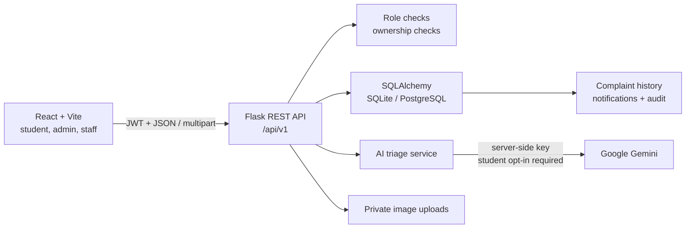
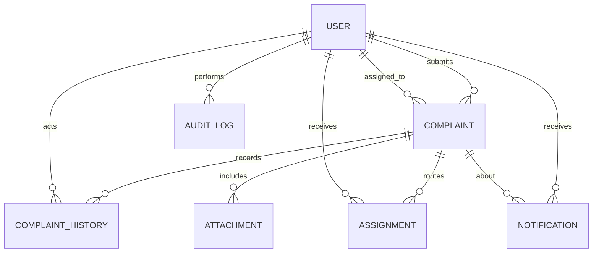

# CampusFix AI architecture

## Request flow

The browser never receives the Gemini API key. Complaint text stays in the
database unless the student opts into AI analysis. Gemini output is stored as
a recommendation; category, priority, assignment, and verified resolution
remain under staff control.

## Data relationships

## Trust boundaries

- The API derives identity and role from a signed, revocable JWT and the user
  row. It never trusts an incoming student ID or role.
- Student complaint reads, writes, comments, notifications, and attachments
  are ownership checked by the backend.
- Staff can only view/update complaints assigned to their account.
- Administrator operations are role-checked on every route.
- Uploads are limited to 5 MB and PNG, JPEG, or WebP magic bytes. Files are
  stored outside the frontend's public directory under random names.
- AI has explicit processing states and failure handling. AI-generated fields
  are separate from the student-selected category and administrator corrections.
- Signing secrets are mandatory, at least 32 characters, and must be distinct.
- Gemini is disabled by default. When enabled, an atomic database-backed UTC
  daily request cap applies across users and workers; it bounds requests, not
  dollar spend. Provider billing alerts remain necessary.
